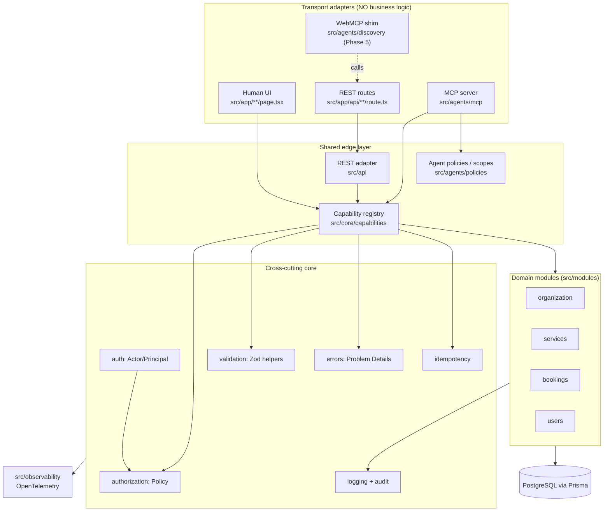

# Architecture — agenticweb

> Status: Phase 1 (Foundation). Authoritative for structure; `CONTRACTS.md` is authoritative for *how to extend it*.

## 1. Goal

A reference architecture for an **agent-ready website**: one product, three consumption channels, one set of business rules.

| Channel | Consumer | Transport | Status |
|---|---|---|---|
| Human UI | People | Next.js App Router (RSC) | Phase 1 slice (read-only) |
| REST + OpenAPI | Programmatic clients, agents | HTTP/JSON, `application/problem+json` errors | Phase 1 slice (read-only), OpenAPI Phase 4 |
| Remote MCP | AI agents | Streamable HTTP at `/mcp` | Phase 4 (contracts in Phase 1) |
| WebMCP | In-browser agents | `navigator.modelContext` tools, progressive enhancement | Phase 5, optional |

## 2. Domain: consulting studio

A small consulting studio sells **services** (e.g. "Architecture Review", 90 min, 15000 INR-minor-units…), exposes bookable **slots** per service, and customers create **bookings** against slots.

* `Organization` — the studio (single-tenant today, but every row carries `organizationId` so multi-tenant is a data change, not a rewrite; also the unit for IDOR checks).
* `Service` — name, slug, description, `durationMinutes`, `priceMinor` + `currency`, `active`.
* `Slot` — a concrete bookable window for a service: `startsAt`, `endsAt`, `capacity` (1 for 1:1 consulting), derived availability.
* `Booking` — a user's reservation of a slot. States: `pending → confirmed → cancelled` (`completed` later). Created with an **idempotency key**.
* `User` — customer or admin. Agents are *not* users; they are **actors acting on behalf of a user** (see §5).

Products are deliberately omitted: no second aggregate would exercise a different pattern than services.

## 3. Style: modular monolith

One deployable (Next.js), strict internal module boundaries. Dependencies point **inward only**.



ASCII fallback:

```
 Human UI ─┐
 REST API ─┼─► Capability registry ─► authorize(actor) ─► validate(zod) ─► module service ─► Prisma ─► Postgres
 MCP tools ┘        (one definition)        └── audit log + idempotency + problem+json errors ──┘
 WebMCP ──► (calls the same REST endpoints from the browser; no separate logic)
```

### Dependency rules (enforced by review, ESLint boundary rules in Phase 6)

1. `src/modules/*` may import `src/core/*` only. Never `src/app`, `src/api`, `src/agents`.
2. `src/core/*` imports nothing from modules (capability registry is generic; modules register into it from `src/capabilities.ts`).
3. Channels (`src/app`, `src/api`, `src/agents`) import capabilities and core, never Prisma directly.
4. A module never imports another module's repository; it uses the other module's **service interface**.

## 4. One capability, many channels

A **capability** is the unit of product behaviour: `{ name, summary, input: ZodSchema, output: ZodSchema, authorize(actor,input), execute(ctx,input), http: {method,path}, mcp: {toolName, scopes, readOnly} }`.

* REST routes are 5-line adapters: parse request → `invokeCapability(name, actor, rawInput)` → envelope.
* MCP tools are generated from the registry (`toMcpTools(registry)`); JSON Schema comes from the same Zod schema.
* The OpenAPI document (Phase 4) is generated from the same registry.
* UI server components call `invokeCapability` directly with the session actor (no HTTP hop).

This is what makes divergence structurally hard: there is exactly one place where input validation, authorization and behaviour are defined.

## 5. Identity and delegation

`Actor` is a discriminated union: `anonymous | user | admin | agent`.

An **agent actor** always carries `onBehalfOf` (a user id or `null` for public-read agents), a **delegation** (`grantId`, `scopes[]`, `expiresAt`, optional `audience`) and a `clientId`. Effective permission = `scopes ∩ onBehalfOf's own permissions ∩ capability requirement`. An agent can never exceed the user who delegated; this is the confused-deputy defence. Token issuance/verification (OAuth 2.1 style with resource indicators, per MCP authorization spec) is Phase 3/4; Phase 1 defines the types and the policy.

## 6. Cross-cutting contracts (all in `src/core`)

| Concern | Location | Contract |
|---|---|---|
| Errors | `core/errors` | `AppError` hierarchy → RFC 9457 `application/problem+json` with stable `code` |
| Envelope | `core/errors/envelope.ts` | `{ data, meta }` success; problem+json failure |
| AuthN | `core/auth` | `Actor`, `AuthContext`, resolver interface |
| AuthZ | `core/authorization` | `AuthorizationPolicy.can(actor, action, resource)` |
| Validation | `core/validation` | Zod parse → `ValidationError` with field issues |
| Idempotency | `core/idempotency` | `IdempotencyStore` + key rules for mutating capabilities |
| Audit | `core/logging/audit.ts` | `AuditLog.record(event)`; every mutation and every denied call |
| Logging | `core/logging` | Structured JSON logger, redaction |
| Capabilities | `core/capabilities` | registry shape (§4) |

## 5b. Data

PostgreSQL 16, Prisma 7 with the `pg` driver adapter. Money as integer minor units. Times as UTC `timestamptz`. Slot overbooking prevented by a transactional capacity check plus a unique constraint on (`slotId`, `idempotencyKey`) (Phase 2).

## 7. Deployment shape

Single Next.js container + Postgres. `/api/health` (liveness, no dependencies) and `/api/ready` (readiness, checks DB). Stateless; sessions/tokens are verifiable without server memory. Observability via OpenTelemetry (Phase 6); logs to stdout.

## 8. Error and response shape (summary)

Success: `{"data": …, "meta": {"requestId": "…"}}`. Failure: `application/problem+json` with `type`, `title`, `status`, `detail`, `instance`, `code`, `requestId`, optional `errors[]`. MCP tools map the same problem to `isError: true` with the problem JSON as text content.

## 9. Non-goals (Phase 1)

Payments, email, calendars sync, multi-tenant admin UI, products, i18n.
